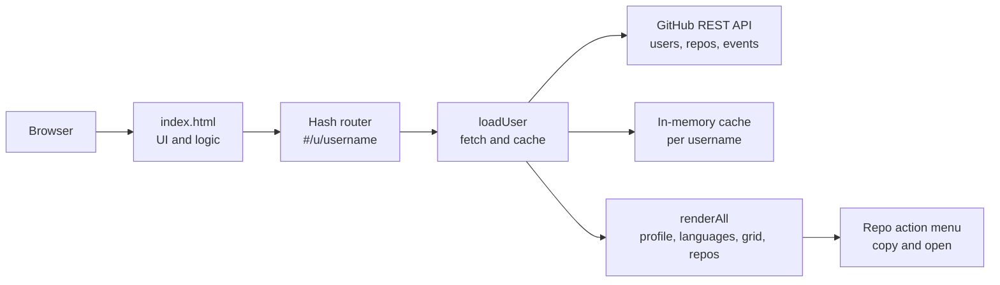
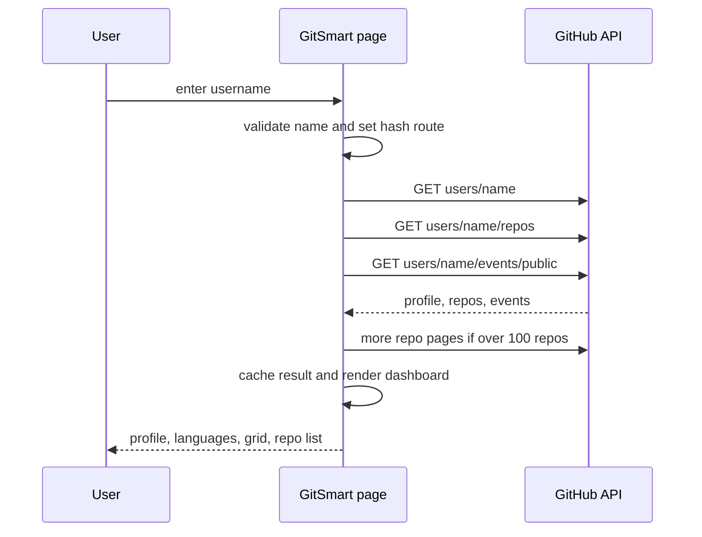

<a name="readme-top"></a>

<p align="center">
  <picture>
    <source media="(prefers-color-scheme: dark)" srcset="https://capsule-render.vercel.app/api?type=waving&color=0:101311,100:E0A458&height=180&section=header&text=GitSmart&fontSize=54&fontColor=ECE9E1&fontAlignY=38&animation=fadeIn&desc=Look+through+any+GitHub+profile&descAlignY=62&descSize=17" />
    <source media="(prefers-color-scheme: light)" srcset="https://capsule-render.vercel.app/api?type=waving&color=0:F2C07E,100:E0A458&height=180&section=header&text=GitSmart&fontSize=54&fontColor=101311&fontAlignY=38&animation=fadeIn&desc=Look+through+any+GitHub+profile&descAlignY=62&descSize=17" />
    
  </picture>
</p>

<p align="center">
  <a href="https://arnoldsemase.github.io/gitsmart/"></a>
  <a href="https://docs.github.com/en/rest"></a>
  <a href="#-design-decisions"></a>
  <a href="#-license"></a>
</p>

<p align="center"><strong>GitSmart is a sleek, client-side web application designed to give a comprehensive, streamlined view of any GitHub profile.</strong></p>

<br>

<p align="center">
  <a href="https://arnoldsemase.github.io/gitsmart/">
    
  </a>
</p>

> [!TIP]
> No install, no setup. Open the link, type a username, press **View profile**.

<br>

<div align="center">

### 🎛️ Quick Facts

| ⚙️ Runtime | 🌐 Data source | 🔐 Auth | ☁️ Hosting |
|:---:|:---:|:---:|:---:|
|  |  |  |  |

</div>

<br>

## Table of Contents

- [Quick Facts](#-quick-facts)
- [Overview](#-overview)
- [Feature Log](#-feature-log)
- [Live Preview](#-live-preview)
- [Architecture](#-architecture)
- [Request Lifecycle](#-request-lifecycle)
- [Project Structure](#-project-structure)
- [Configuration](#-configuration)
- [Running Locally](#-running-locally)
- [Deployment](#-deployment)
- [Design Decisions](#-design-decisions)
- [Contributing](#-contributing)
- [License](#-license)

<br>

## 🔍 Overview

<table>
  <tr>
    <td width="60%" valign="top">
      <p>Type any GitHub username into <b>GitSmart</b> and it builds a full readout: profile summary, language mix, recent public activity, a 26-week activity grid and a searchable, sortable list of every public repository, each with a quick health label.</p>
      <p>It is one static HTML file with no framework, no build step and no backend. The browser talks straight to the public <a href="https://docs.github.com/en/rest">GitHub REST API</a>, so there is nothing to host except the page itself.</p>
    </td>
    <td width="40%" valign="top" align="center">
      <code>#/u/torvalds</code> → shareable profile link<br>
      <code>Ctrl / ⌘ + K</code> → jump to search<br>
      <code>/</code> → focus repo filter<br>
      <code>Esc</code> → close menus<br><br>
      <code>open index.html</code>
    </td>
  </tr>
</table>

<p align="center">
  
</p>

## ⚡ Feature Log

| Feature | What it does |
|---|---|
| **Username search** | Accepts `torvalds`, `@torvalds` or a full `github.com/torvalds` URL. Invalid names are rejected before any request is sent. |
| **Profile summary** | Avatar, name, location, bio, plus repo, star, fork and follower counts. |
| **Top languages** | The five most common languages as a share of repositories, with the rest grouped as *Other*. |
| **Activity grid** | A 26-week grid of daily squares built from recent public events and last-push dates. |
| **Recent activity** | The latest five public events: pushes, pull requests, issues, stars, forks and new repos. |
| **Repository list** | Filter by text, type (all, sources, forks, open issues) and sort by recent push, stars, forks, open issues or name. Loads 30 at a time. |
| **Health labels** | Each repo is marked *Active*, *Inactive* (no push in 180 days), *Needs attention* (8 or more open issues), *Many open issues* (over 15) or *Archived*. |
| **Quick actions** | Per-repo menu to copy the clone URL, copy the repo name, open on GitHub or open the homepage. |
| **Shareable URLs** | Every profile has its own hash route, so a link opens straight to that user. |
| **Rate-limit meter** | Shows the remaining GitHub API requests for the hour and explains clearly when the limit is hit. |

<br><br>

## 📱 Live Preview

This is the structure of a profile view, using the same fields the page really renders:

```
@torvalds                          Linus Torvalds · Portland, OR
Repos 8   Stars 200k+   Forks 60k+   Followers 230k

Top languages (share of repositories)
C ████████████░░░░  70%
Other ███░░░░░░░░░  30%

Activity grid · 26 weeks
░░▒░░▓░░░▒░░░▓▓░░▒░░░░▒▓░░░▒░░░░░░▒░░▓
 ...each square is one day

Repositories                 Showing 8 of 8 repositories
┌────────────────────────────────────────────────────────┐
│ linux                                    ● Active       │
│ Linux kernel source tree                 ⭐ 200k  🍴 60k │
│ C                                        Pushed Oct 2026│
└────────────────────────────────────────────────────────┘
```

<p align="center">
  
  
</p>

<br><br>

## 🏗️ Architecture

GitSmart is intentionally small: one page, one data source, zero persistence. That is a deliberate choice, not an omission. See [Design Decisions](#-design-decisions).



All state lives in one small object in the page. Nothing is written to disk, cookies or local storage, so closing the tab leaves nothing behind.

<br><br>

## 🔄 Request Lifecycle

**Loading a profile**



**Rate limits**

| Case | Requests used |
|---|---|
| Typical profile (up to 100 repos) | 3 |
| Large profile (up to 300 repos) | 4 to 5 |
| Re-opening a profile in the same visit | 0 (served from cache) |

GitHub allows 60 unauthenticated requests per hour per IP. The header meter shows what is left.

<p align="right"><a href="#readme-top">↑ back to top</a></p>

<br>

## 📁 Project Structure

```
gitsmart/
├── index.html            → Markup, styles and all application logic
├── logo.svg              → Brand mark and SVG favicon
├── favicon-32.png        → PNG favicon
├── apple-touch-icon.png  → iOS home-screen icon
└── icon-512.png          → Social preview and large icon
```

**Design principle:** everything the page needs ships in this folder, so it works when dropped on any static host.

<br><br>

## 🔧 Configuration

GitSmart needs no environment variables, API keys or secrets. The few constants live at the top of the script in `index.html`:

| Constant | Default | Description |
|---|---|---|
| `PAGE` | `30` | Repositories shown per "Show more" step. |
| `API` | `https://api.github.com` | GitHub REST API base URL. |
| Repo pages fetched | `3` | Up to 300 repositories per user (100 per page). |
| Events fetched | `100` | Recent public events used for the activity feed and grid. |
| Grid window | `26` weeks | Width of the activity grid. |

> [!NOTE]
> GitHub's public events endpoint only goes back about 90 days, so the activity grid can miss older work.

<br><br>

## 👨‍💻 Running Locally

**1 · Clone**
```bash
git clone https://github.com/arnoldsemase/arnoldsemase.github.io
cd arnoldsemase.github.io/gitsmart
```

**2 · Serve the folder**
```bash
npx serve .
```
Or open `index.html` directly in a browser. Both work, since there is no build step.

**3 · Try it**

Open the local address and search for a username such as `torvalds`.

<p align="center">
  
</p>

## ☁️ Deployment

GitSmart is served by **GitHub Pages** from the `gitsmart/` folder of the `arnoldsemase.github.io` repository.

1. Push changes to the default branch.
2. GitHub Pages publishes the folder automatically.
3. Visit `https://arnoldsemase.github.io/gitsmart/`.

> [!TIP]
> Any static host works the same way (Netlify, Cloudflare Pages, Azure Static Web Apps). Upload the folder and you are done.

<br><br>

## 🧭 Design Decisions

A few choices here are deliberate trade-offs, not defaults left unexamined:

- **No backend.** The browser calls the public GitHub API directly. There is no server to run, secure or pay for.
- **No token, no login.** Reading public data needs no authentication, so there is nothing for users to hand over and nothing for the project to leak.
- **No build step or framework.** One HTML file with vanilla JavaScript loads fast, deploys anywhere and stays readable for years.
- **Honest numbers.** Language shares are by repository count, not bytes, and the activity grid says plainly where its data ends. Labels describe what is measured instead of implying more.
- **Cache per visit, store nothing.** Profiles are cached in memory to save API requests, and nothing persists after the tab closes.

<br><br>

<p align="right"><a href="#readme-top">↑ back to top</a></p>

<br>

## 🤝 Contributing

Issues and pull requests are welcome. For anything non-trivial, please open an issue first to discuss the change. This keeps the project a single, dependency-free page rather than growing a build toolchain.

<br><br>

## 📬 License

Released under the **ISC License**.

<div align="center">
<sub>Built with 🖤 and vanilla JavaScript · If GitSmart saved you a click, consider giving the repo a ⭐</sub>
<br>
<small>© 2026 Arnold Semase. All Rights Reserved.</small>
</div>

<br>

<p align="center">
  
</p>
 
