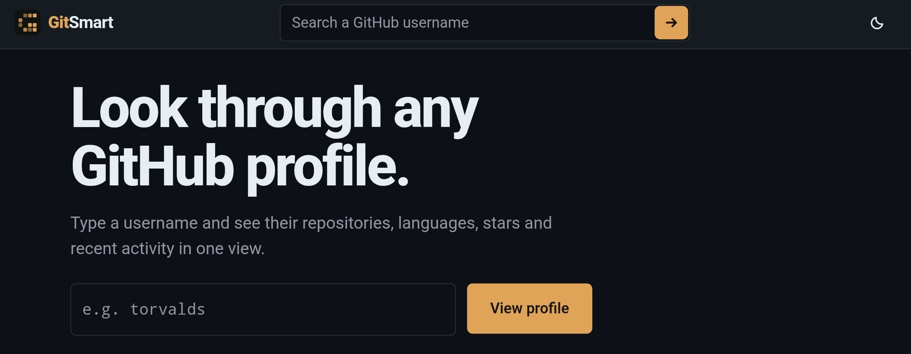

<a name="readme-top"></a>

<p align="center">
  <picture>
    <source media="(prefers-color-scheme: dark)" srcset="https://capsule-render.vercel.app/api?type=waving&color=0:101311,100:E0A458&height=180&section=header&text=GitSmart&fontSize=54&fontColor=ECE9E1&fontAlignY=38&animation=fadeIn&desc=Look+through+any+GitHub+profile&descAlignY=62&descSize=17" />
    <source media="(prefers-color-scheme: light)" srcset="https://capsule-render.vercel.app/api?type=waving&color=0:F2C07E,100:E0A458&height=180&section=header&text=GitSmart&fontSize=54&fontColor=101311&fontAlignY=38&animation=fadeIn&desc=Look+through+any+GitHub+profile&descAlignY=62&descSize=17" />
    
  </picture>
</p>

<p align="center">
  
  
  
  
</p>

<p align="center"><strong>Type a GitHub username. See repositories, languages, stars and recent activity in one view.</strong></p>

<p align="center">
  
</p>

<p align="center">
  <a href="https://arnoldsemase.github.io/gitsmart/">
    
  </a>
</p>

> [!TIP]
> No install, no sign-up. Open the link, type a username, press **View profile**.

<p align="center">
  
</p>

## ⚡ Features

- **Profile summary** with avatar, bio, location, repos and followers
- **Repositories** with languages, stars, forks and last push
- **Recent activity** from public GitHub events
- **Shareable links** like `#/u/torvalds`
- **Light and dark** theme, mobile friendly

## 🧭 How it works

The browser calls the public GitHub API directly. No server, no token, no database. Results are cached for 10 minutes to save requests.

> [!NOTE]
> GitHub allows 60 unauthenticated requests per hour per visitor. A profile uses about 3.

## 👨‍💻 Run it

```bash
npm install
npm run dev      # local preview
npm run build    # outputs web/dist
```


## 📬 License

Released under the **MIT License**.

<div align="center">
<sub>Built with 🖤 by <a href="https://github.com/arnoldsemase">Arnold Semase</a> · If GitSmart saved you a click, give it a ⭐</sub>
</div>

<p align="center">
  <a href="#readme-top">↑ back to top</a>
</p>

<p align="center">
  
</p>
